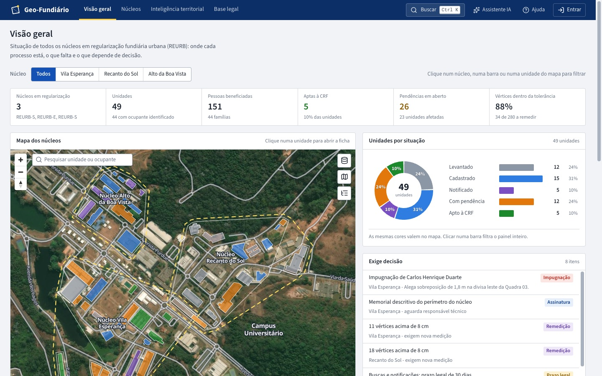
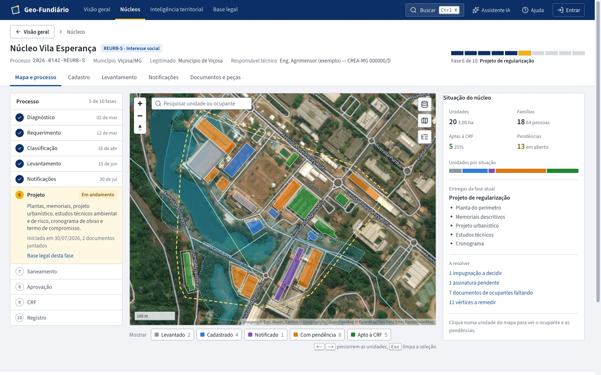
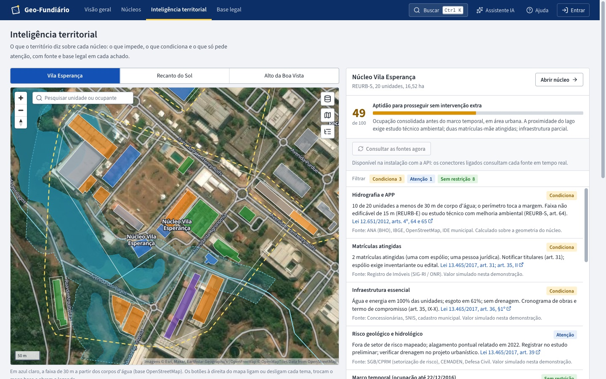
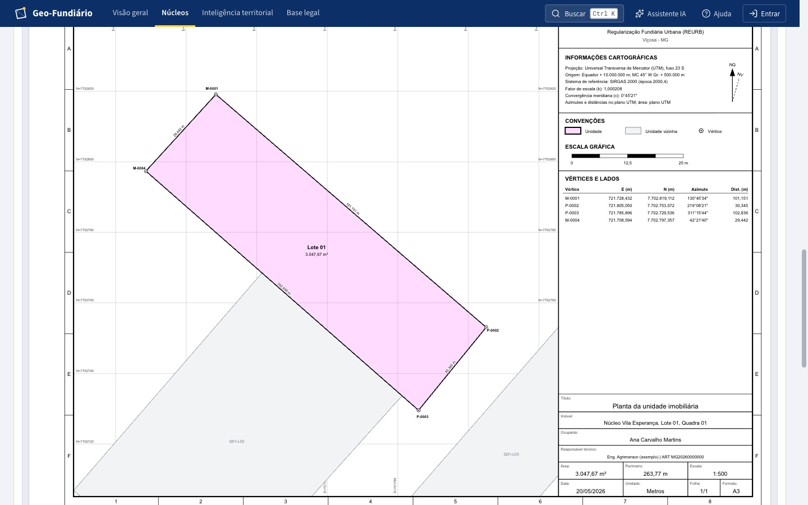
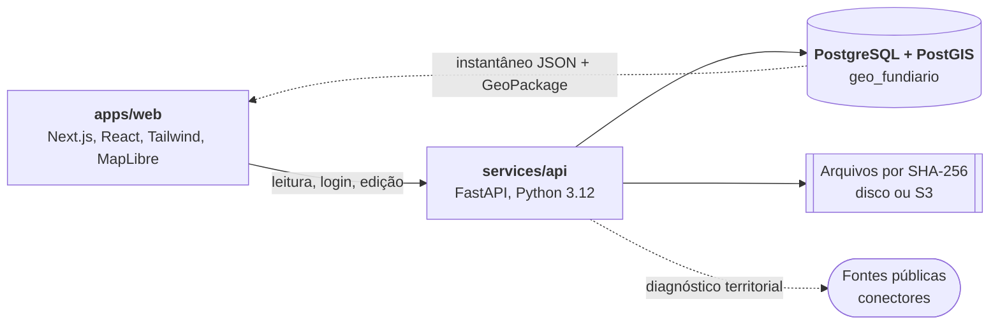
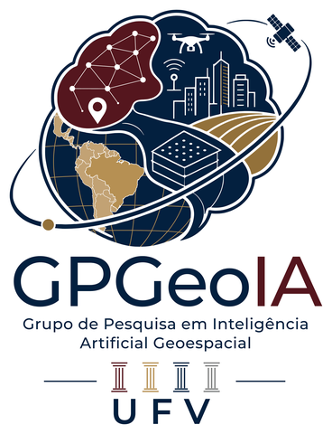

<h1 align="center">Geo-Fundiário</h1>

<p align="center">
  Plataforma aberta de <strong>gestão fundiária e territorial</strong>:<br>
  do levantamento de campo às peças técnicas, do cadastro ao registro.
</p>

<p align="center">
  <a href="https://darlanmnunes.github.io/geo-fundiario/"><strong>Abrir a demonstração</strong></a>
  &nbsp;|&nbsp;
  <a href="docs/marco-legal-e-fluxo-reurb.md">Marco legal</a>
  &nbsp;|&nbsp;
  <a href="docs/seguranca.md">Segurança</a>
  &nbsp;|&nbsp;
  <a href="#como-rodar">Como rodar</a>
</p>

<p align="center">
  <a href="https://github.com/darlanmnunes/geo-fundiario/actions/workflows/ci.yml"></a>
  <a href="https://github.com/darlanmnunes/geo-fundiario/actions/workflows/pages.yml"></a>
  <a href="LICENSE"></a>
  
  
</p>

<p align="center">
  <a href="https://darlanmnunes.github.io/geo-fundiario/"></a>
</p>

O primeiro módulo é a **Regularização Fundiária Urbana (REURB)**, conforme a Lei 13.465/2017 e o Decreto 9.310/2018. O núcleo cadastral, a geodésia, os documentos e a inteligência territorial são compartilhados e servem de base para os próximos módulos. O código é livre, da estrutura do banco à interface.

> [!NOTE]
> **Protótipo funcional com dados fictícios.** Os três núcleos da demonstração foram simulados sobre edificações do campus da UFV (geometria do OpenStreetMap, ODbL). Nenhum desses prédios está em regularização e nenhuma pessoa citada existe.

## Sumário

- [O que o sistema faz](#o-que-o-sistema-faz)
- [Telas](#telas)
- [Arquitetura](#arquitetura)
- [Como rodar](#como-rodar)
- [Demonstração pública](#demonstração-pública)
- [Situação e próximos passos](#situação-e-próximos-passos)
- [Autoria](#autoria)
- [Licença](#licença)

## O que o sistema faz

| Área | O que entrega |
|---|---|
| **Visão geral** | Painel do gestor: indicadores, mapa de todos os núcleos, unidades por situação, andamento das dez fases e a lista do que exige decisão. Os gráficos filtram o painel e o mapa. |
| **Núcleo** | Mapa com imagem, unidades coloridas por situação, trilha das fases do art. 28 com prazos e entregas, inspetor da unidade. |
| **Cadastro** | Unidades e ocupantes com renda, família, CPF mascarado e documentos faltantes; perfil socioeconômico do núcleo. |
| **Ficha da unidade** | Vértices com método e erro posicional, azimutes e distâncias, confrontantes por topologia, critérios de legitimação fundiária (art. 23) e documentos do ocupante. |
| **Peças técnicas** | Memorial descritivo em DOCX, planta em A3 com malha e selo, DXF e GeoPackage do núcleo, todos gerados dos vértices. |
| **Levantamento** | Controle de qualidade por vértice contra a tolerância da norma do projeto: 8 cm tridimensional na REURB (Dec. 9.310/2018, art. 29) ou os limites planimétricos do georreferenciamento rural. |
| **Notificações** | Art. 31: destinatário, meio, ciência, prazo de 30 dias e resposta. |
| **Documentos** | Autos do processo por fase, com código de verificação pública e assinaturas. |
| **Inteligência territorial** | Dossiê de cada núcleo por tema (APP, risco, marco temporal, matrículas, unidades de conservação e outros), com base legal e fonte em cada achado. |
| **Base legal** | As dez fases com os artigos que as regem e link para o texto de cada lei e norma. |
| **Acesso** | Login por perfil (leitor, editor, administrador); cada gravação fica na auditoria com o autor. |
| **Assistente IA** | Estrutura para perguntas em linguagem natural ao banco, por um papel somente leitura sobre visões sem dado pessoal. |

## Telas

| Núcleo: mapa e processo | Inteligência territorial |
|---|---|
|  |  |

<p align="center">
  <br>
  <sub>Planta da unidade em A3, gerada dos vértices do banco.</sub>
</p>

## Arquitetura



O banco é a única fonte de dados. A demonstração estática lê um instantâneo exportado dele; a instalação completa lê a API.

| Esquema | Conteúdo |
|---|---|
| `ladm` | Núcleo cadastral ISO 19152: partes, unidades administrativas, direitos, restrições e responsabilidades, unidades espaciais, vértices com método e precisão |
| `reurb` | Projetos, fases com prazos legais, situação das unidades, pendências, notificações (Lei 13.465/2017) |
| `campo` | Levantamento e cadastro social |
| `documentos` | Anexos, versões, assinaturas e código de verificação |
| `inteligencia` | Catálogo de camadas, conectores, dossiês e achados |
| `metadados` | Conjuntos de dados no Perfil MGB 2.0 e correspondência com a INDE |
| `acesso` | Usuários, perfis e sessões |
| `consulta` | Visões somente leitura, sem dado pessoal, para o Assistente IA |
| `auditoria` | Registro imutável de toda alteração, com autor |

Decisões de modelagem:

- **LADM (ISO 19152)** no núcleo cadastral, com versionamento temporal: nada é sobrescrito.
- **SIRGAS 2000 geográfico (EPSG:4674)** como geometria canônica. Áreas, azimutes e distâncias saem no plano UTM do projeto; a área no plano topográfico local é calculada à parte.
- **Tolerância posicional pela norma do projeto**, cadastrada em catálogo, e não um valor fixo.
- **Documentos**: metadados no PostgreSQL, bytes fora do banco endereçados por SHA-256. Não há segundo banco.
- **Segurança**: papéis separados no banco, segurança por linha, limites por cliente na API. Detalhes em [docs/seguranca.md](docs/seguranca.md).

## Como rodar

Pré-requisitos: Node 20+, [uv](https://docs.astral.sh/uv/), PostgreSQL 14+ com PostGIS 3 (no macOS, Postgres.app).

```bash
# 1. Banco
createdb geo_fundiario
for f in db/migrations/*.sql; do psql -d geo_fundiario -v ON_ERROR_STOP=1 -1 -f "$f"; done

# 2. Dados de demonstração (fictícios, sobre edificações do campus da UFV tiradas do OpenStreetMap)
(cd services/api && uv run python scripts/gerar_seed.py)
psql -d geo_fundiario -f db/seed/seed.sql

# 3. Instantâneo que a interface lê (JSON) e GeoPackage de cada núcleo
(cd services/api && uv run python scripts/exportar_instantaneo.py)

# 4. Primeiro administrador (a senha é pedida no terminal)
(cd services/api && uv run python scripts/criar_admin.py "Seu Nome" voce@exemplo.br)

# 5. API em http://localhost:8000/docs
(cd services/api && uv run uvicorn geo_fundiario.main:app --reload --port 8000)

# 6. Interface em http://localhost:3000, ligada à API (login, edição e leitura ao vivo)
(cd apps/web && npm install && NEXT_PUBLIC_API_URL=http://localhost:8000 GEOF_API_URL=http://localhost:8000 npm run dev)
```

**O banco é a única fonte de dados.** Sem `GEOF_API_URL`, a interface lê o instantâneo exportado do banco
(`apps/web/src/data/instantaneo.json`); é assim que a demonstração estática funciona. Sem
`NEXT_PUBLIC_API_URL`, ela fica somente de leitura.

Verificação:

```bash
(cd services/api && uv run pytest && uv run ruff check src tests scripts)
(cd apps/web && npm run typecheck && npm run lint && npm run build)
```

Segurança, perfis de acesso e passos para produção: [docs/seguranca.md](docs/seguranca.md).

## Demonstração pública

A cada push em `main`, o fluxo `.github/workflows/pages.yml` publica a interface como site estático, somente de leitura, em <https://darlanmnunes.github.io/geo-fundiario/>. Login, edição, envio de documentos e consulta ao vivo às fontes só existem na instalação com a API.

Para gerar o site localmente: `NEXT_OUTPUT=export NEXT_BASE_PATH=/<nome-do-repo> npm run build` em `apps/web` (saída em `out/`).

## Situação e próximos passos

| Módulo | Situação |
|---|---|
| REURB, regularização fundiária urbana | protótipo funcional |
| Inteligência territorial | hidrografia consultada ao vivo (OpenStreetMap); demais temas simulados |
| Cadastro territorial multifinalitário, regularização rural, georreferenciamento de imóveis | planejados |

1. Módulo de diagnóstico territorial com conectores às fontes oficiais.
2. Importação de levantamentos (CSV de GNSS e estação total, GeoPackage, DXF) pelo navegador.
3. Peças em PDF com QR de verificação: CRF, listagem de ocupantes, notificações, edital.
4. Projeto QGIS pronto junto do GeoPackage.
5. Aplicativo de campo offline para cadastro socioeconômico e coleta.
6. Integração com o Registro de Imóveis (ONR/SAEC) quando o leiaute oficial for verificado.

## Autoria

<a href="http://dgp.cnpq.br/dgp/espelhogrupo/833723"></a>

Desenvolvido pelo **[GPGeoIA - Grupo de Pesquisa em Inteligência Artificial Geoespacial](http://dgp.cnpq.br/dgp/espelhogrupo/833723)** da Universidade Federal de Viçosa (UFV), registrado no Diretório dos Grupos de Pesquisa do CNPq.

Responsável: Prof. Dr. Darlan Miranda Nunes.

<br clear="left">

## Licença

Código sob a **GNU Affero General Public License v3.0 ou posterior** ([LICENSE](LICENSE)). Quem usar ou oferecer o sistema como serviço, inclusive modificado, disponibiliza o código correspondente nos mesmos termos. Os dados de base do OpenStreetMap seguem a ODbL. Material didático e documentação de apoio terão licença própria, indicada em cada arquivo quando publicados.
